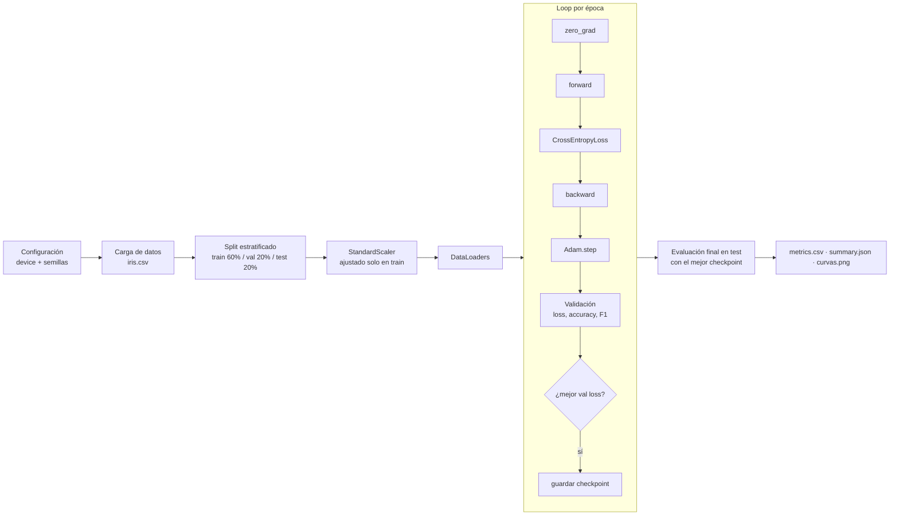
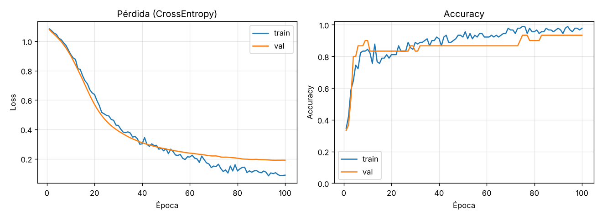

# Pipeline base de entrenamiento y validación en PyTorch

Primer checkpoint del Proyecto Final: infraestructura reproducible para entrenar y validar un clasificador base (MLP) sobre el dataset **Iris**. El foco está en la calidad del pipeline, no en la complejidad del modelo.

## Estructura del repositorio

```
.
├── data/
│   └── iris.csv            # dataset de referencia (150 muestras, 4 features, 3 clases)
├── src/
│   ├── config.py           # hiperparámetros, detección de dispositivo y semillas
│   ├── data.py             # split estratificado train/val/test, escalado y DataLoaders
│   ├── model.py            # arquitectura MLP (nn.Module + nn.Sequential)
│   ├── engine.py           # training loop y función de evaluación
│   └── train.py            # punto de entrada del experimento
├── outputs/                # métricas por época, resumen y curvas del experimento
├── requirements.txt
└── README.md
```

## Cómo ejecutarlo

```bash
python -m venv .venv && source .venv/bin/activate   # Windows: .venv\Scripts\activate
pip install -r requirements.txt
python src/train.py                                  # opcional: --lr 1e-3 --epochs 100 --batch-size 16 --seed 42
```

El script genera en `outputs/`: `metrics.csv` (loss, accuracy y F1 por época), `summary.json` (configuración y resultado en test), `curvas.png` y `best_model.pt` (no versionado).

## Diagrama conceptual del pipeline



## Componentes

**Entorno.** `get_device()` elige automáticamente CUDA, luego MPS (Apple Silicon) y si no hay ninguno, CPU. `set_seed()` fija las semillas de `random`, `numpy` y `torch` y activa el modo determinista de cuDNN, y el `DataLoader` de entrenamiento usa un `torch.Generator` con semilla propia. Al correr el experimento dos veces se obtienen métricas idénticas.

**Arquitectura.** MLP de dos capas ocultas: `Linear(4→16) → ReLU → Dropout(0.1) → Linear(16→16) → ReLU → Dropout(0.1) → Linear(16→3)`. Tiene 403 parámetros. La salida son logits (sin softmax) porque `nn.CrossEntropyLoss` aplica `log_softmax` internamente.

**Training loop** (`engine.train_one_epoch`). En cada batch: `optimizer.zero_grad()` → forward → pérdida → `loss.backward()` (autograd) → `optimizer.step()` con Adam. Los tensores se mueven con `.to(device)` al mismo dispositivo que el modelo.

**Validación** (`engine.evaluate`). Usa `model.eval()` y `@torch.no_grad()`, y calcula loss, accuracy y F1 macro sobre datos que el modelo no ve durante el entrenamiento. Se guarda el checkpoint con menor pérdida de validación, y el conjunto de test se usa una sola vez al final.

**Prevención de data leakage.** El `StandardScaler` se ajusta solo con train. Los tres splits son estratificados, así que conservan la proporción de clases.

## Experimento inicial

| Parámetro | Valor |
|---|---|
| Versión de PyTorch | **2.15.0** (build `+cu132`; ejecutado en CPU) |
| Learning rate (Adam) | **1e-3** |
| Épocas | 100 |
| Batch size | 16 |
| Semilla | 42 |
| Splits | train 90 / val 30 / test 30 |

**¿Por qué `learning_rate = 1e-3`?** Es el valor por defecto recomendado para Adam y funciona bien en redes chicas con features estandarizadas. Con este dataset produce un descenso estable, sin las oscilaciones que aparecerían con un lr más alto, y converge en menos de 100 épocas.

### Resultados

| Época | Train loss | Train acc | Val loss | Val acc | Val F1 |
|---:|---:|---:|---:|---:|---:|
| 1 | 1.085 | 0.344 | 1.079 | 0.333 | 0.167 |
| 20 | 0.638 | 0.811 | 0.570 | 0.833 | 0.822 |
| 50 | 0.269 | 0.922 | 0.266 | 0.867 | 0.865 |
| 100 | 0.088 | 0.978 | 0.190 | 0.933 | 0.933 |

**Test (mejor checkpoint):** loss 0.166 · accuracy 0.900 · F1 macro 0.900



### Interpretación de la curva de pérdida

**La pérdida bajó de forma sostenida durante todas las épocas.** Empieza cerca de 1.10 ≈ ln(3), que es la pérdida esperada de un clasificador que asigna probabilidad uniforme a las 3 clases. Eso confirma que la inicialización es correcta. La caída más pronunciada ocurre entre las épocas 10 y 40, y después la curva se aplana.

Hasta la época ~45 las curvas de train y validación prácticamente se superponen. Después, la pérdida de entrenamiento sigue bajando (0.088) mientras que la de validación se estabiliza alrededor de 0.19. Esta brecha es una **señal temprana y leve de sobreajuste**: el modelo empieza a ajustar detalles propios del set de entrenamiento. Igual, la pérdida de validación nunca vuelve a subir, por eso el mejor checkpoint es el de las últimas épocas. La accuracy de validación sigue mejorando hasta 0.933.

La curva de train tiene ruido de batch a batch por el mini-batch (16 muestras) y el dropout. La de validación es suave porque se evalúa sin dropout.

**Próximos pasos.** Agregar early stopping con paciencia sobre la pérdida de validación, probar `weight_decay` para reducir la brecha train/val y usar validación cruzada, porque con solo 30 muestras de validación cada error mueve la accuracy 3.3 puntos.

## Errores comunes que el pipeline evita

- **Olvidar `zero_grad()`:** se llama al inicio de cada iteración del loop, antes del forward.
- **Inconsistencia de dispositivos:** modelo y batches se mueven con `.to(device)`, y las predicciones se pasan a CPU solo para calcular métricas con scikit-learn.
- **Evaluar con dropout activo o calculando gradientes:** la evaluación usa `model.eval()` + `torch.no_grad()`.
